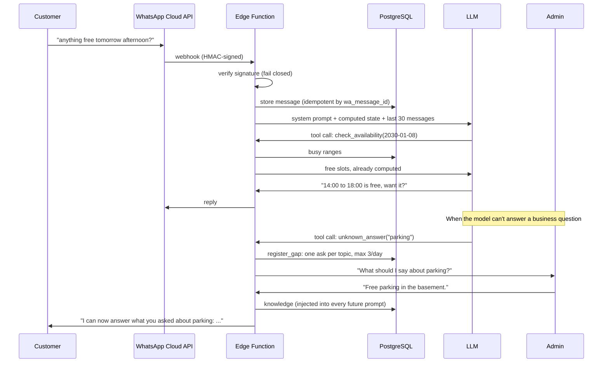

# WhatsApp Booking Agent

[](https://github.com/amaurymoeno123-cyber/whatsapp-booking-agent/actions/workflows/ci.yml)

An LLM agent that takes bookings over WhatsApp and **learns answers from the staff**. Runs as a
Supabase Edge Function (Deno) on PostgreSQL.

This is the open, generalized version of a system I built and run in production for a streaming
studio in Medellín, Colombia: creators book studio time by text or voice note, staff approve, and
the bot handles the conversation in Spanish. Client data, prompts and branding are removed. The
design decisions below explain what changed and why.

## How it works



## Design decisions

Most of these come from bugs that real traffic exposed in the production version.

| Decision | Why |
| --- | --- |
| Free slots are computed in code and handed to the model | Given only busy ranges, the model was asked "what's free?" five times in a row and never got it right. |
| History is the **last** 30 messages, sorted in code | `order asc limit 30` returns the *first* 30. Past message 30 the bot kept answering an old message. |
| Bookings can't overlap: a PostgreSQL exclusion constraint | Checking availability and then inserting races when two people book the same hour; the constraint makes it atomic. |
| Signature check fails closed | The original returned `true` when the secret was missing, so anyone with the URL could inject messages. |
| Webhook work is awaited before responding | Background `waitUntil` work was cut mid-task by the edge runtime and the bot went silent. |
| Every path ends in a reply or an alert | From outside, a bot that stays silent is indistinguishable from one that is down. |
| Delivery receipts are stored | A 200 from the send API is not a delivery. Meta can drop the message later (e.g. error 131042). |
| Users without a visible number are kept | They arrive with `from_user_id` instead of `from`; requiring `from` drops them silently. |
| Staff takeover expires after 24 h | If someone takes over a chat and forgets to hand it back, that customer would be ignored forever. |
| Bot script lives in a table | Tuning the wording is an `UPDATE`, not a redeploy. |

## Security

- RLS on every table, **no policies**: only the edge function (service role) reads or writes.
- Functions revoked from `public`, `anon` and `authenticated`. In Supabase every new function is
  callable with the public anon key unless revoked, and revoking from `anon` alone is not enough
  because the default grant goes to `PUBLIC`. The schema tests check this as the `anon` role.
- Secrets only as Edge Function secrets. `.env*` is ignored from the first commit.

## Project layout

```
src/
  agent.ts        tool-calling loop, model-agnostic (ChatModel interface)
  tools.ts        tool specs + handlers over a BookingRepo interface
  slots.ts        time math: free slots, overlaps, date validation
  inbound.ts      Meta webhook payload -> typed events
  history.ts      stored rows -> chat history
  prompt.ts       system prompt with computed state
  learning.ts     admin-answer rules
  signature.ts    X-Hub-Signature-256 verification
  adapters.ts     OpenAI, WhatsApp Cloud API, Supabase implementations
supabase/
  migrations/     schema, RLS, functions, grants
  functions/      the webhook (wiring only)
  tests/          SQL tests run against real PostgreSQL in CI
tests/            Deno unit tests (no network, no database)
```

Everything with logic is a pure function or takes its dependencies as an interface, so the tests
need no network and no mocks of HTTP.

## Run it

```bash
deno task check          # fmt, lint, type check, unit tests
```

Deploy:

```bash
supabase db push
supabase secrets set META_APP_SECRET=... WA_VERIFY_TOKEN=... WA_TOKEN=... \
  WA_PHONE_NUMBER_ID=... OPENAI_API_KEY=...
supabase functions deploy whatsapp-webhook --no-verify-jwt   # Meta can't send a Supabase JWT
```

Then point the WhatsApp webhook to the function URL and insert the bot script:

```sql
insert into bot_config (key, value) values ('system_prompt', 'You are the booking assistant of ...');
insert into admins (phone, name) values ('57300...', 'Owner');
```

## Not included

Kept out to stay focused: the staff panel (approve bookings, read chats, take over), message
templates for writing outside the 24-hour window, and image handling. In production those exist;
admin questions outside the 24-hour window need an approved template.

## License

MIT
